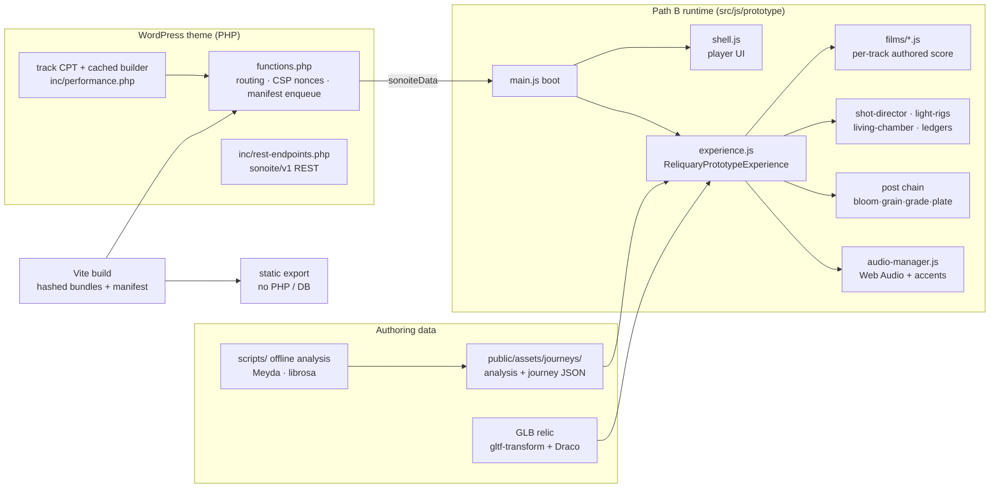

# Sonoite: an album performed as a chamber film

*Sonoite* is a seven-track album I wrote and produced, and this is its browser-native listener. Each track is played as a short film: one sculpture (a hand holding a flower and an egg) in a dark room, lit and filmed by an authored score in real time with Three.js while the music plays.

It is not a music visualizer. The camera, the sculpture and the chapters of each film are **authored to the music's structure** (measured to the second). Live audio analysis only adds the breathing and accents on top.

> **Live demo:** _link coming soon (static build of Tracks 1, 4 and 5)_. Best on desktop Chrome or Safari, with headphones.


| Track 1 · *Sonoite* (FRACTURE phase) | Track 5 · *Não querer nada* (hard key) | Track 4 · *Horas mortas* (player UI) |
|---|---|---|
|  |  |  |

---

## Status: work in progress, honestly stated

| | |
|---|---|
| **Built chamber films** | Track 1 *Sonoite* (8:59), Track 4 *Horas mortas* (6:31), Track 5 *Não querer nada* (9:24) |
| **Not yet built** | Tracks 2, 3, 6, 7. They still run on the legacy particle runtime and are not linked from the front page |
| **Tests** | 791 Jest tests in 50 suites; 790 pass. The one failure is a heap-size assertion in the legacy `SecurityManager` suite that is timing-dependent and fails intermittently |
| **Build** | `npm run build` is clean (Vite 7) |
| **Lint** | Not enforced. The WordPress ESLint preset was adopted late; ~84 % of its reports are its tab-indent rule against this 4-space codebase |
| **Open creative work** | Owner listening passes on the September trials, endings and transitions between tracks, and the remaining four films |

This repository is a **curated snapshot** of a private working repo (595 commits, July 2025 to October 2026). Session logs, superseded audits and the abandoned first direction were left out so the code and current documents are easy to read.

---

## What's interesting here

**1. The film is a score, not a reaction.** Each built track has a film module (`src/js/prototype/films/*.js`) holding its phase windows, camera cue list, lighting score and event beats, timed to measured moments in the master. The doctrine (`docs/qa/MUSIC_INTERACTION_MATRIX.md`) is **70 % authored arc / 25 % autonomous breathing / 5 % audio punctuation**. Camera, sculpture, phases and palette *never* react to live audio. Only things felt below conscious notice do, such as haze density, rim intensity and grain.

**2. A "state ledger" instead of curves.** The October rework of Tracks 4 and 5 replaced smooth parameter curves with discrete, measured states and one irreversible "ratchet". In Track 5, tar spreads over the sculpture and never recedes. The light offers the object, takes it back, and after the collapse returns *with the exact same key and framing*, so the only change you see is the contamination. The rule: *if the viewer can't tell what changed, the change didn't happen.* See `docs/qa/track5-ledger-2026-10-02/LEDGER.md`.

**3. A custom real-time render path.** One GLTF relic (Draco or quantized meshes, optimized with `gltf-transform`) in a shader-built chamber. It uses a hand-rolled post chain (bloom → grain → vignette → per-phase colour grade → film plate → blackout), AgX tone mapping, manual shadow-map cadence and quality-dependent frame pacing (30/24/12 fps). The grade crossfades between phase palettes every frame.

**4. Audio in two layers.**
- **Offline:** Meyda and librosa analysis of the masters, giving beats, phases, spectral bands and phrase anchors (`scripts/`, output in `public/assets/journeys/analysis/`). This is used for *authoring*.
- **Live:** a Web Audio `AudioManager` with noise gates and EMA smoothing, and an accent detector feeding the 5 % punctuation layer. Transport is wall-clock anchored, so seeks stay in sync with the film.

**5. A WordPress theme that can also leave WordPress.** The theme registers a `track` custom post type, serves a `sonoite/v1` REST API (rate-limited and cached), and enqueues hashed Vite bundles from the manifest under a nonce-based CSP. `scripts/build-static-prototype.mjs` exports the same experience as a static site with no PHP or database, for hosting on Vercel or Netlify.

**6. Tested where it matters.** The tests pin the authored behaviour: film configs, ledger state windows, shot director, light rigs, transport resume, track routing, and the static export. A refactor that silently moves a cue or breaks a seek fails the suite.

---

## Architecture



```
src/js/prototype/      ← the current runtime (Path B chamber films), ~22k lines
  films/               ← one authored score per track + registry
  experience.js        ← scene, render loop, post chain, chamber variants
  shell.js             ← all player UI (DOM + injected CSS)
  track4-ledger.js, track5-ledger.js, shot-director.js, light-rigs.js, ...
src/js/                ← shared audio manager + the legacy runtime (Tracks 2/3/6/7)
inc/, *.php            ← WordPress layer: routing, REST, CPT, security headers
scripts/               ← audio analysis, GLB optimisation, static export, validators
tests/                 ← Jest (jsdom) suites
docs/qa/               ← current-state audits, doctrine, and the latest review rounds
.claude/agents/        ← the specialist reviewer agents used during development
```

A deeper map (all three runtimes, query flags, gotchas) is in [`CLAUDE.md`](CLAUDE.md), which is the working brief the coding agents read.

---

## How it was built: one director, many AI collaborators

I worked as **creative director and product owner**. The implementation was done by AI coding agents working under explicit gates. The process is documented in the repo, because that's where most of the craft went.

- **Orchestration.** A Claude model (Fable 5.1) acted as orchestrator: it wrote the specs with exact acceptance criteria, checked diffs, ran the browser verification and kept project memory. Implementation went to the Codex and Cursor CLIs against those specs. Every change was a numbered prompt commit (up to `Prompt #247`).
- **Independent review rounds.** Before major changes, two reviewer models (Fable and Astra) received the same read-only brief and evidence sheets and reviewed separately. A synthesis document then recorded where they converged and disagreed, and the build followed the convergence. See `docs/qa/track5-ledger-2026-10-02/` (rounds A → B → C) and `docs/qa/aesthetic-review-round2-2026-10-01/`.
- **Listening as data.** Because most models can't hear, Gemini did listening passes over the masters. Its timings were then **graded against measurement** (0.25 s resolution) before anything was scored to them (`docs/qa/gemini-listening-2026-10-01/`).
- **Owner-gated passes.** Nothing became the default without my judging it live. Every trial shipped behind a URL flag (`?ledger=1`, `?proposal=stage`, …) with the previous film intact, so A/B comparison was always one click away.
- **Specialist agents.** `.claude/agents/` holds seven role prompts used for focused reviews: noir cinematographer, look-dev director, audiovisual synergy mapper, JS expert, and others.
- **Evidence over claims.** The working rules are explicit. A visual claim needs a fresh build and a state dump, not a screenshot someone didn't inspect. "Pass" means the full suite (`npm run test:full`). Audit findings are re-verified against current code before anyone fixes them.

The biggest lesson was the **March 2026 product reset** (`docs/qa/END_GOAL_AND_PRODUCT_RESET.md`). Eight months in, the original particle "void" direction looked impressive and felt like nothing. I stopped, wrote down what the product *is* (a room that performs the music, not a visualizer) and rebuilt from a single lit sculpture.

---

## Running it

**Requirements:** Node 20.19+ or 22.12+ (Vite 7), and for the WordPress route PHP 7.4+ with WordPress 6.x.

```bash
npm ci
npm run build        # Vite → dist/ (WordPress always serves dist/)
npm run test:full    # full Jest suite
```

**As a WordPress theme.** Clone into `wp-content/themes/sonoite-theme`, run `npm ci && npm run build`, then activate it. The front page boots Track 1. Use `?track=horas-mortas` or `?track=nao-querer-nada` for the other films. Tracks come from the `track` post type, with audio in the media library.

**As a static site (no WordPress).** The album audio is not distributed in this repo. Point the export at a folder containing the MP3s:

```bash
npm run build
node scripts/build-static-prototype.mjs --out dist-static --uploads /path/to/album-mp3s
npx serve dist-static          # or deploy the folder to Vercel / Netlify
```

Useful flags on any route: `?track=<slug>`, `?quality=cinema`, `?ledger=1` (Track 4/5 state ledgers), `?proposal=intimate|chamber|afterimage|stage`, `?debug=1`. The full list is parsed in `src/js/prototype/film-flags.js`.

---

## Stack

Three.js 0.160 · Web Audio API · Vite 7 · Jest 29 (jsdom) · WordPress (PHP, REST API, custom post types) · Meyda and librosa (offline analysis) · gltf-transform and Draco · GLSL

## Licence

Code: [GPL-2.0-or-later](LICENSE), as WordPress themes require. The album audio is not included and is not licensed for reuse. The sculpture model was generated with Meshy AI and processed in Blender. Track 1 stage textures are CC0 from ambientCG (sources in `public/assets/materials/track1-stage/*-source.json`).
