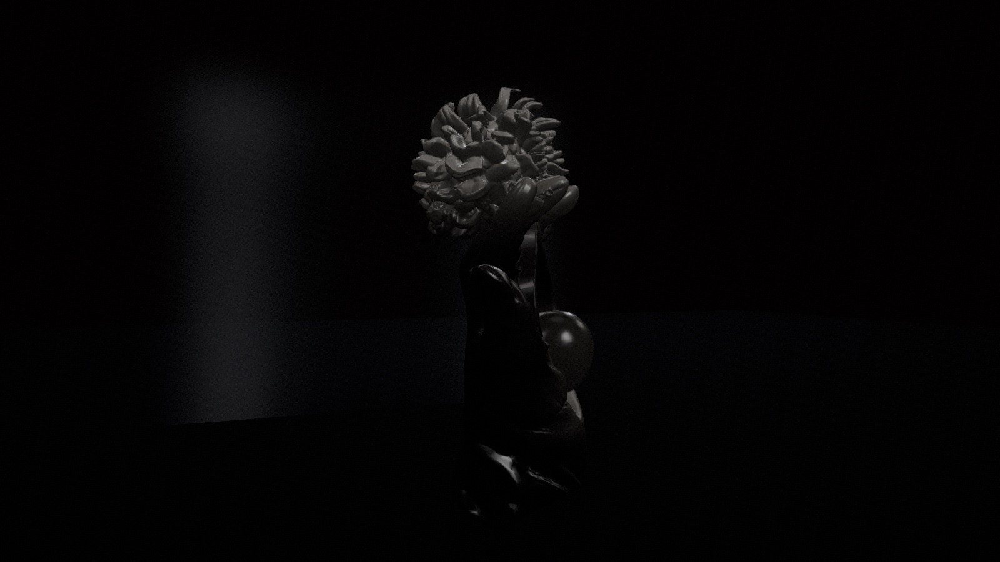
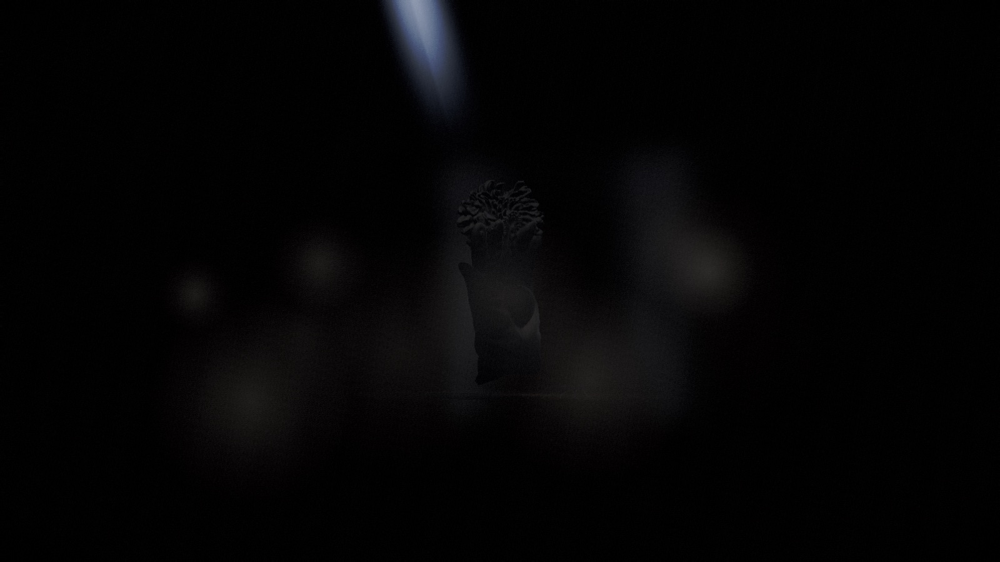
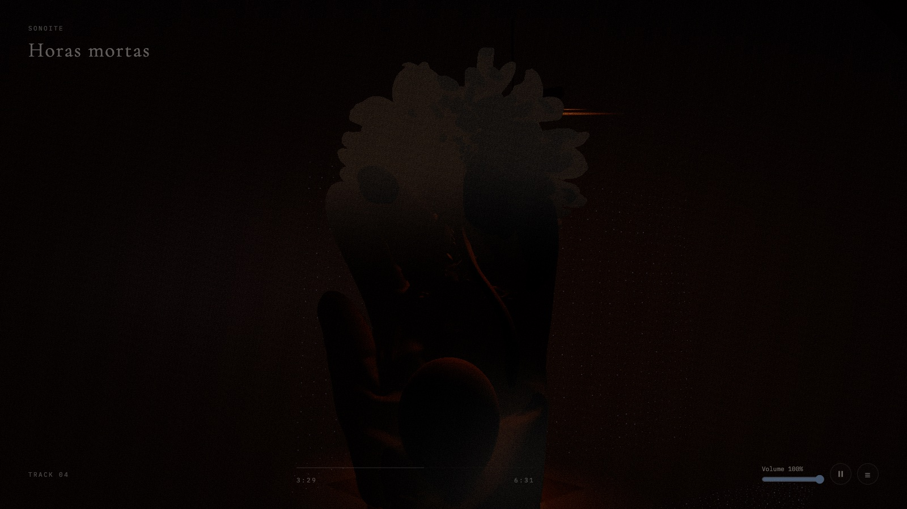
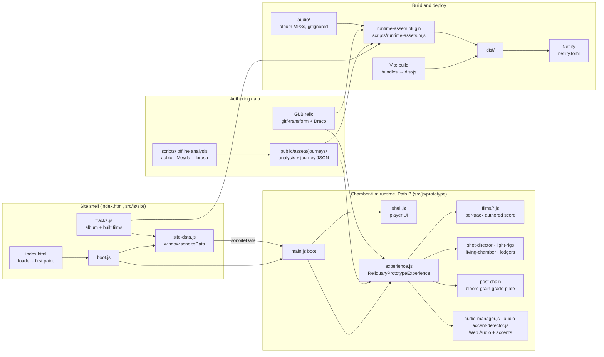

# Sonoite: an album performed as a chamber film

> **Work in progress.** Three of the album's seven films are built (Tracks 1, 4 and 5). Tracks 2, 3, 6 and 7 are not built yet. Development is ongoing.

*Sonoite* is a seven-track album I wrote and produced, and this is its browser-native listener. Each track is meant to play as a film: one sculpture (a hand holding a flower and an egg) in a dark room, lit and filmed in real time with Three.js by a score authored for that track while the music plays.

It is not a music visualizer. The camera, the sculpture's light and the chapters of each film are **authored to the music's structure**, timed to moments measured in the master. Live audio analysis only adds breathing and accents on top.

> **Live demo:** an unlisted build of Tracks 1, 4 and 5, shared on request. Best on desktop Chrome or Safari, with headphones.


| Track 1 · *Sonoite* (FRACTURE phase) | Track 5 · *Não querer nada* (hard key) | Track 4 · *Horas mortas* (player UI) |
|---|---|---|
|  |  |  |

---

## Status

| Area | State |
|---|---|
| **Built chamber films** | Track 1 *Sonoite* (8:59), Track 4 *Horas mortas* (6:31), Track 5 *Não querer nada* (9:24) |
| **Not yet built** | Tracks 2, 3, 6, 7. No film yet, so not playable in this build (`?track=` only serves the three built films). The pre-reset particle runtime that used to play them (`src/js/main.js` → `init-experience.js` → `three-experience.js`) is kept as source and tests, for reference when building those films; it is not built or loaded |
| **Trials** | The October state-ledger trials (Tracks 4, 5) and September staging proposals run behind URL flags; none is the default yet |
| **Tests** | 792 Jest tests in 47 suites, all passing (`npm test`). Coverage is low (~21 % of lines) and concentrated on the chamber-film runtime (about half of its lines; about 5 % elsewhere) |
| **Build** | `npm run build` succeeds (Vite 7) with one warning, chunk size: the app bundle (~782 kB) and the Three.js vendor chunk (~655 kB) are over Vite's 500 kB default. Without the album audio it still builds, with a warning |
| **Lint** | Not enforced yet: ~2.7k reports, almost all in the legacy runtime (kept as source, not built). The chamber-film runtime and its shared modules have 116, mostly a security-plugin heuristic and missing JSDoc `@param` tags |
| **Open work** | Owner listening passes on the trials, endings and transitions between tracks, the remaining four films, and the [known limitations](#known-limitations) |

This repository is a **curated snapshot** of a private working repo (602 commits, July 2025 to October 2026). Session logs, superseded audits and the creative documents of the abandoned first direction were left out; that direction's particle runtime is still in `src/js/` for reference, but nothing builds or loads it.

---

## Design and engineering choices

**1. The film is a score, not a reaction.** Each built track has a film module (`src/js/prototype/films/*.js`) holding its phase windows, camera cue list, lighting score and event beats, timed to measured moments in the master. The doctrine (`docs/qa/MUSIC_INTERACTION_MATRIX.md`) is **70 % authored arc / 25 % autonomous breathing / 5 % audio punctuation**. Camera framing, sculpture, phases and palette are authored, not driven by live audio, with two small, clamped exceptions documented at the top of `src/js/prototype/commit-reactions.js` (a breathing offset on camera height and relic sway, and a mid-band term on the relic's iridescence). Otherwise audio drives the 5 % punctuation accents and small modulations meant to stay below conscious notice, such as haze density, rim intensity and grain.

**2. A "state ledger" instead of curves.** The October ledger trials for Tracks 4 and 5 (opt-in: `?track=nao-querer-nada&ledger=1`, `?track=horas-mortas&ledger=f|a`; not yet owner-adopted) replace smooth parameter curves with discrete, measured states and one irreversible "ratchet". In Track 5, tar spreads over the sculpture and never recedes. The light offers the object, takes it back, and after the collapse returns *with the exact same key and framing*, so the only change you see is the contamination. The rule: *if the viewer can't tell what changed, the change didn't happen.* See `docs/qa/track5-ledger-2026-10-02/LEDGER.md`.

**3. A custom real-time render path.** One GLTF relic (Draco or quantized meshes, optimized with `gltf-transform`) in a shader-built chamber. It uses a custom post chain on Three's EffectComposer (stock bloom, then hand-written grain → vignette → per-phase color grade → film plate → blackout passes), AgX tone mapping, manual shadow-map updates and quality-dependent frame pacing (30/24/12 fps). The grade crossfades between phase palettes every frame.

**4. Audio in two layers.**
- **Offline:** analysis of the masters in `scripts/` (`deep-audio-analysis.cjs`, using ffmpeg and aubio, for beats, onsets and energy phases; Meyda for spectral features; a librosa extractor is included), written to `public/assets/journeys/analysis/` and used for authoring. Track 1's and Track 5's beat grids are authored rather than detected: a hand-set 140 BPM grid (`scripts/build-sonoite-beats.mjs`) and a grid built from hand-placed phrase anchors (`scripts/build-track5-beats.cjs`). Track 5's grid also drives its shot director at runtime.
- **Live:** a Web Audio `AudioManager` (FFT bands) feeding phase-dependent smoothing in the chamber, plus an adaptive spectral-flux accent detector (`audio-accent-detector.js`) for the 5 % punctuation layer. Transport is wall-clock anchored, so seeks stay in sync with the film.

**5. A static site, with no server.** `index.html` loads one script, `src/js/site/boot.js`, which imports the page data first (`site-data.js`: the built films from `tracks.js`, the asset base URL, the relic) and then the chamber-film runtime. `npm run build` bundles it with Vite, and a small build plugin copies the files the films fetch by URL (fonts, Draco decoder, relic GLBs, journey and beat data, listed once in `scripts/runtime-assets.mjs`) plus the album audio into `dist/`, which deploys to any static host. This one is set up for Netlify (`netlify.toml`). WordPress was the original host: the project was a WordPress theme (custom post type, REST API, nonce-based CSP) until October 2026. That version is tagged [`wordpress-theme`](https://github.com/rremedio-web/sonoite/tree/wordpress-theme), and the commit after it removed the PHP layer.

**6. Tests, and their known weakness.** Behavioral suites pin the ledger state windows, the shot director, chamber-variant isolation, the transport lifecycle and the site's page data and asset list. Older suites guard the film scores, transport ordering and light rigs by scraping source text, which is brittle; replacing them with config-level assertions is open work.

---

## Architecture



```
index.html             ← the page: loader, first-paint line, the noscript card; loads src/js/site/boot.js
src/js/site/           ← site shell: boot.js (the only entry), site-data.js (window.sonoiteData), tracks.js (album track list)
src/js/prototype/      ← the chamber-film runtime ("Path B" in CLAUDE.md and docs/), ~22k lines
  films/               ← one authored score per track
  experience.js        ← scene, render loop, post chain, chamber variants
  shell.js             ← all player UI (DOM + injected CSS)
  track4-ledger.js, track5-ledger.js, shot-director.js, light-rigs.js, ...
src/js/                ← modules Path B shares (audio-manager.js, visuals/journey-loader.js, utils/dispose3d.js), and the
                         pre-reset legacy runtime (main.js, init-experience.js, three-experience.js, visuals/, modules/, …),
                         kept as source and tests for reference when building Tracks 2, 3, 6 and 7; not built
public/                ← relic GLBs, journey and beat data, Track 1 stage assets, Draco decoder (the build copies what the films use)
assets/fonts/          ← the two web fonts
audio/                 ← the album MP3s, gitignored (filled by npm run audio:import)
scripts/               ← runtime-assets.mjs (the build's asset list), audio import and check, audio analysis and beat grids,
                         GLB clean-up, journey validator
vite.config.js         ← build and dev-server config, with the runtime-assets plugin
netlify.toml           ← Netlify publish folder and headers (noindex, caching)
tests/                 ← Jest (jsdom) suites
docs/                  ← decision records, audits and review rounds (index: docs/README.md)
.claude/agents/        ← role prompts from the pre-reset phase (process history)
```

A deeper map (runtimes, the site shell and build, query flags, gotchas) is in [`CLAUDE.md`](CLAUDE.md), the working brief the coding agents read. The documentation has its own index with a short reading path: [`docs/README.md`](docs/README.md).

---

## How it was built: one director, several AI collaborators

I worked as **creative director and product owner**. The implementation was done by AI coding agents working under explicit gates, and the process is documented in the repo.

- **Orchestration.** Claude, running in Claude Code, acted as orchestrator (Fable 5.1; the October audit's mechanical gates were run by Opus 5.5). It wrote the specs with exact acceptance criteria, checked diffs and results, and kept project memory. Implementation, and much of the browser capture, went to the Codex and Cursor CLIs against those specs. Since the March 2026 reset, nearly every change in the private repo landed as a numbered prompt commit (the scheme runs from Prompt #1 in September 2025 to #249 so far); this public repo's history starts fresh.
- **Independent review rounds.** In the October 2026 review rounds (1 and 2 October), two reviewer models from different vendors (Claude Fable 5.1 and OpenAI's GPT-6 Astra) received the same brief and evidence sheets and reviewed in separate read-only sessions without seeing each other's answer in that round. A synthesis document then recorded where they converged and disagreed, and the next build followed the convergence. Fable was also the orchestrating model, so where it was reviewing its own proposal the synthesis says so. The evidence is in the repo: `docs/qa/track5-ledger-2026-10-02/` (rounds A → B → C), `docs/qa/aesthetic-second-opinion-2026-10-01/` and `docs/qa/aesthetic-review-round2-2026-10-01/`.
- **Listening as data.** Gemini was the only model in the toolchain that could hear audio, so it did listening passes over the masters. Its timings were then **graded against measurement** of the masters (RMS, band energy, aubio onsets and beats) before anything was scored to them; when the coarse grading smeared Track 5's steps, the key times were re-measured at 0.25 s (`docs/qa/gemini-listening-2026-10-01/`).
- **Owner-gated passes.** Nothing became the default without my judging it live. Trials shipped behind URL flags (`ledger=1`, `proposal=stage`, …) with the default film intact, so A/B comparison was one URL away.
- **Pre-reset agent prompts.** `.claude/agents/` holds seven role prompts (noir cinematographer, look-dev director, audiovisual synergy mapper, JS expert, and others) written in February 2026 for the pre-reset particle runtime. They are kept as process history and do not describe the chamber films.
- **Evidence over claims.** The working rules are explicit. A visual claim needs the running site (the dev server, or a fresh build) and a state dump, not a screenshot nobody inspected. "Pass" means the full suite (`npm test`). Audit findings are re-verified against current code before anyone fixes them.

The biggest lesson was the **March 2026 product reset** (`docs/qa/END_GOAL_AND_PRODUCT_RESET.md`). Eight months in, the original particle "void" direction looked impressive and felt like nothing. I stopped, wrote down what the product *is* (a room that performs the music, not a visualizer) and rebuilt from a single lit sculpture.

---

## Running it

**Requirements:** Node 20.19+ or 22.12+ (Vite 7). Nothing else for the site; the offline analysis scripts need ffmpeg, aubio and Python with librosa.

The album audio is not distributed in this repo; `npm run audio:import` copies your MP3s into the gitignored `audio/` folder. It matches each file by track number and title (e.g. `04 - Horas mortas.mp3` or `04-Horas-mortas.mp3`) and writes normalized names, `01-sonoite.mp3` … `07-homem-educado.mp3`:

```bash
npm ci
npm run audio:import -- /path/to/album-mp3s   # → audio/01-sonoite.mp3 … audio/07-homem-educado.mp3
npm run dev          # dev server with hot reload: http://127.0.0.1:3000/
npm test             # full Jest suite
npm run build        # → dist/: bundles, the runtime assets and the three built films' audio
npm run preview      # serves dist/ at http://127.0.0.1:4173/
npm run deploy       # checks the audio, builds, and uploads dist/ to Netlify (production)
```

Without `audio/` the films have nothing to play, and `npm run build` finishes with a warning and no audio in `dist/`. `npm run deploy` (`audio:check`, then `build`, then `npx netlify-cli deploy --prod --dir dist`) refuses to run without the three films' MP3s, and needs a one-time `npx netlify-cli login`. Netlify does not build the site itself, because the audio is not in git: the site is built locally and uploaded. `dist/` uses relative URLs, so it also works from any other static host, at a domain root or under a sub-path.

The page boots Track 1. Flags work on the bare URL, e.g. `http://127.0.0.1:3000/?proposal=stage`. Useful ones: `?track=horas-mortas` or `?track=nao-querer-nada` (selects the film), `?quality=cinema`, `?track=nao-querer-nada&ledger=1` (Track 5 state ledger), `?track=horas-mortas&ledger=f` or `&ledger=a` (Track 4 ledger arms), `?track=<slug>&proposal=intimate|chamber|afterimage|stage`, `?track=nao-querer-nada&relic=meshy` (Track 5 with the Meshy relic instead of the Blender one), `?debug=1`. Flags are parsed in `src/js/prototype/film-flags.js`, `cinematic-proposals.js`, `shell.js` (`?debug=`) and the `uses*()`/`resolve*()`/`get*()` methods of `experience.js`.

---

## Known limitations

- The build ships only the files listed in `scripts/runtime-assets.mjs`, while the dev server serves the whole project. Two things therefore work in dev but not on a built site: `?relic=materials` (its material-study GLB is not shipped and, by design, nothing stands in for it, so the room never opens and the page stays on the black loader), and the reduced-motion journeys in `public/assets/journeys/phase42/reduced/` (a visitor with reduced motion gets the normal journey data instead; the runtime's own reduced-motion handling still applies).
- The dev server needs port 3000 free (`strictPort`); it does not move to another port.

---

## Stack

Three.js 0.160 · Web Audio API · Vite 7 · Jest 29 (jsdom) · Netlify (static hosting) · aubio, Meyda and librosa (offline analysis) · gltf-transform and Draco · GLSL

## License

Code: [GPL-2.0-or-later](LICENSE). The album audio is not included and is not licensed for reuse. The sculpture model was generated with Meshy AI and optimized with gltf-transform. Track 1 stage textures are CC0 from ambientCG (sources in `public/assets/materials/track1-stage/*-source.json`).
