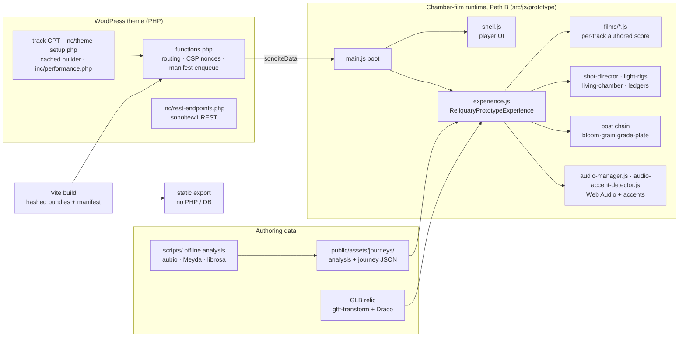

# Sonoite: an album performed as a chamber film

> **Work in progress.** Three of the album's seven films are built (Tracks 1, 4 and 5). Tracks 2, 3, 6 and 7 are not built yet. Development is ongoing.

*Sonoite* is a seven-track album I wrote and produced, and this is its browser-native listener. Each track is meant to play as a film: one sculpture (a hand holding a flower and an egg) in a dark room, lit and filmed in real time with Three.js by a score authored for that track while the music plays.

It is not a music visualizer. The camera, the sculpture's light and the chapters of each film are **authored to the music's structure**, timed to moments measured in the master. Live audio analysis only adds breathing and accents on top.

> **Live demo:** _link coming soon (static build of Tracks 1, 4 and 5)_. Best on desktop Chrome or Safari, with headphones.


| Track 1 · *Sonoite* (FRACTURE phase) | Track 5 · *Não querer nada* (hard key) | Track 4 · *Horas mortas* (player UI) |
|---|---|---|
|  |  |  |

---

## Status

| Area | State |
|---|---|
| **Built chamber films** | Track 1 *Sonoite* (8:59), Track 4 *Horas mortas* (6:31), Track 5 *Não querer nada* (9:24) |
| **Not yet built** | Tracks 2, 3, 6, 7. No film yet, so not playable in this build (`?track=` only serves the three built films). The pre-reset particle runtime that used to play them (`src/js/main.js` → `init-experience.js` → `three-experience.js`) is kept in source; its player is not routed |
| **Trials** | The October state-ledger trials (Tracks 4, 5) and September staging proposals run behind URL flags; none is the default yet |
| **Tests** | 789 Jest tests in 49 suites, all passing (`npm test`). Coverage is low (~21 % of lines) and concentrated on the chamber-film runtime (about half of its lines; about 5 % elsewhere) |
| **Build** | `npm run build` succeeds (Vite 7) with three Rollup warnings: chunk size (the Three.js vendor chunk), and two mixed static/dynamic imports in the legacy runtime |
| **Lint** | Not enforced yet: ~2.7k reports, almost all in the frozen legacy runtime. The chamber-film runtime and its shared modules have 122, mostly a security-plugin heuristic and missing JSDoc `@param` tags |
| **Open work** | Owner listening passes on the trials, endings and transitions between tracks, the remaining four films, and the WordPress [known issues](#known-issues) |

This repository is a **curated snapshot** of a private working repo (595 commits, July 2025 to October 2026). Session logs, superseded audits and the creative documents of the abandoned first direction were left out; that direction's particle runtime is still in `src/js/` for reference, but its player is not routed.

---

## Design and engineering choices

**1. The film is a score, not a reaction.** Each built track has a film module (`src/js/prototype/films/*.js`) holding its phase windows, camera cue list, lighting score and event beats, timed to measured moments in the master. The doctrine (`docs/qa/MUSIC_INTERACTION_MATRIX.md`) is **70 % authored arc / 25 % autonomous breathing / 5 % audio punctuation**. Camera framing, sculpture, phases and palette are authored, not driven by live audio, with two small, clamped exceptions documented at the top of `src/js/prototype/commit-reactions.js` (a breathing offset on camera height and relic sway, and a mid-band term on the relic's iridescence). Otherwise audio drives the 5 % punctuation accents and small modulations meant to stay below conscious notice, such as haze density, rim intensity and grain.

**2. A "state ledger" instead of curves.** The October ledger trials for Tracks 4 and 5 (opt-in: `?track=nao-querer-nada&ledger=1`, `?track=horas-mortas&ledger=f|a`; not yet owner-adopted) replace smooth parameter curves with discrete, measured states and one irreversible "ratchet". In Track 5, tar spreads over the sculpture and never recedes. The light offers the object, takes it back, and after the collapse returns *with the exact same key and framing*, so the only change you see is the contamination. The rule: *if the viewer can't tell what changed, the change didn't happen.* See `docs/qa/track5-ledger-2026-10-02/LEDGER.md`.

**3. A custom real-time render path.** One GLTF relic (Draco or quantized meshes, optimized with `gltf-transform`) in a shader-built chamber. It uses a custom post chain on Three's EffectComposer (stock bloom, then hand-written grain → vignette → per-phase color grade → film plate → blackout passes), AgX tone mapping, manual shadow-map updates and quality-dependent frame pacing (30/24/12 fps). The grade crossfades between phase palettes every frame.

**4. Audio in two layers.**
- **Offline:** analysis of the masters in `scripts/` (`deep-audio-analysis.cjs`, using ffmpeg and aubio, for beats, onsets and energy phases; Meyda for spectral features; a librosa extractor is included), written to `public/assets/journeys/analysis/` and used for authoring. Track 1's and Track 5's beat grids are authored rather than detected: a hand-set 140 BPM grid (`scripts/build-sonoite-beats.mjs`) and a grid built from hand-placed phrase anchors (`scripts/build-track5-beats.cjs`). Track 5's grid also drives its shot director at runtime.
- **Live:** a Web Audio `AudioManager` (FFT bands) feeding phase-dependent smoothing in the chamber, plus an adaptive spectral-flux accent detector (`audio-accent-detector.js`) for the 5 % punctuation layer. Transport is wall-clock anchored, so seeks stay in sync with the film.

**5. A WordPress theme that can also leave WordPress.** The theme registers a `track` custom post type, serves a `sonoite/v1` REST API (rate-limited and cached), and enqueues hashed Vite bundles from the manifest under a nonce-based CSP. `scripts/build-static-prototype.mjs` exports the same experience as a static site with no PHP or database, for hosting on Vercel or Netlify.

**6. Tests, and their known weakness.** Behavioral suites pin the ledger state windows, the shot director, chamber-variant isolation and the transport lifecycle. Older suites guard the film scores, transport ordering, light rigs and the static exporter by scraping source text, which is brittle; replacing them with config-level assertions is open work.

---

## Architecture



```
src/js/prototype/      ← the chamber-film runtime ("Path B" in CLAUDE.md and docs/), ~22k lines
  films/               ← one authored score per track
  experience.js        ← scene, render loop, post chain, chamber variants
  shell.js             ← all player UI (DOM + injected CSS)
  track4-ledger.js, track5-ledger.js, shot-director.js, light-rigs.js, ...
src/js/                ← shared audio manager, the preview page, and the pre-reset legacy runtime (its player is not routed; the preview template still boots it)
inc/, *.php            ← WordPress layer: routing, REST, CPT, security headers
scripts/               ← audio analysis and beat grids, GLB clean-up, static export, journey validator
tests/                 ← Jest (jsdom) suites
docs/                  ← decision records, audits and review rounds (index: docs/README.md)
.claude/agents/        ← role prompts from the pre-reset phase (process history)
```

A deeper map (runtimes, routing, query flags, gotchas) is in [`CLAUDE.md`](CLAUDE.md), the working brief the coding agents read. The documentation has its own index with a short reading path: [`docs/README.md`](docs/README.md).

---

## How it was built: one director, several AI collaborators

I worked as **creative director and product owner**. The implementation was done by AI coding agents working under explicit gates, and the process is documented in the repo.

- **Orchestration.** Claude, running in Claude Code, acted as orchestrator (Fable 5.1; the October audit's mechanical gates were run by Opus 5.5). It wrote the specs with exact acceptance criteria, checked diffs and results, and kept project memory. Implementation, and much of the browser capture, went to the Codex and Cursor CLIs against those specs. Since the March 2026 reset, nearly every change in the private repo landed as a numbered prompt commit (the scheme runs from Prompt #1 in September 2025 to #247); this public repo's history starts fresh.
- **Independent review rounds.** In the October 2026 review rounds (1 and 2 October), two reviewer models from different vendors (Claude Fable 5.1 and OpenAI's GPT-6 Astra) received the same brief and evidence sheets and reviewed in separate read-only sessions without seeing each other's answer in that round. A synthesis document then recorded where they converged and disagreed, and the next build followed the convergence. Fable was also the orchestrating model, so where it was reviewing its own proposal the synthesis says so. The evidence is in the repo: `docs/qa/track5-ledger-2026-10-02/` (rounds A → B → C), `docs/qa/aesthetic-second-opinion-2026-10-01/` and `docs/qa/aesthetic-review-round2-2026-10-01/`.
- **Listening as data.** Gemini was the only model in the toolchain that could hear audio, so it did listening passes over the masters. Its timings were then **graded against measurement** of the masters (RMS, band energy, aubio onsets and beats) before anything was scored to them; when the coarse grading smeared Track 5's steps, the key times were re-measured at 0.25 s (`docs/qa/gemini-listening-2026-10-01/`).
- **Owner-gated passes.** Nothing became the default without my judging it live. Trials shipped behind URL flags (`ledger=1`, `proposal=stage`, …) with the default film intact, so A/B comparison was one URL away.
- **Pre-reset agent prompts.** `.claude/agents/` holds seven role prompts (noir cinematographer, look-dev director, audiovisual synergy mapper, JS expert, and others) written in February 2026 for the pre-reset particle runtime. They are kept as process history and do not describe the chamber films.
- **Evidence over claims.** The working rules are explicit. A visual claim needs a fresh build and a state dump, not a screenshot nobody inspected. "Pass" means the full suite (`npm test`). Audit findings are re-verified against current code before anyone fixes them.

The biggest lesson was the **March 2026 product reset** (`docs/qa/END_GOAL_AND_PRODUCT_RESET.md`). Eight months in, the original particle "void" direction looked impressive and felt like nothing. I stopped, wrote down what the product *is* (a room that performs the music, not a visualizer) and rebuilt from a single lit sculpture.

---

## Running it

**Requirements:** Node 20.19+ or 22.12+ (Vite 7). For the WordPress route: PHP 7.4+ and WordPress 5.7+ (tested up to 7.1).

```bash
npm ci
npm run build        # Vite → dist/ (WordPress always serves dist/)
npm test             # full Jest suite
```

**As a WordPress theme.** Clone into `wp-content/themes/sonoite-theme`, run `npm ci && npm run build`, then activate it. The front page boots Track 1. Use `?track=horas-mortas` or `?track=nao-querer-nada` for the other films. Tracks come from the `track` post type, with audio in the media library. Their slugs must match the built-film list (`BUILT_TRACK_CYCLE` in `src/js/prototype/shell.js`: `sonoite`, `horas-mortas`, `nao-querer-nada`) for the chamber films to boot.

**As a static site (no WordPress).** The album audio is not distributed in this repo. Point the export at a folder containing the MP3s, named `01-…mp3`, `04-…horas-mortas…mp3` and `05-…nao-querer-nada…mp3`:

```bash
npm run export:static -- --uploads /path/to/album-mp3s   # build + export to dist-static/
npx serve dist-static          # or deploy the folder to Vercel / Netlify
```

Useful flags: `?track=<slug>`, `?quality=cinema`, `?track=nao-querer-nada&ledger=1` (Track 5 state ledger), `?track=horas-mortas&ledger=f` or `&ledger=a` (Track 4 ledger arms), `?track=<slug>&proposal=intimate|chamber|afterimage|stage`, `?debug=1`. On WordPress, start trial URLs with `?track=` (see CLAUDE.md, Routes and flags). Flags are parsed in `src/js/prototype/film-flags.js`, `cinematic-proposals.js`, `shell.js` (`?debug=`) and the `uses*()`/`resolve*()`/`get*()` methods of `experience.js`.

---

## Known issues

These are in the WordPress admin and PHP layer. They need a live WordPress install to verify, so they are being fixed in the private working repo first.

- The subscriber CSV export runs inside the admin page callback, so its download headers are sent after the page has started printing.
- Attachment audio URLs are read from `posts.guid`, which keeps the old domain after a site migration; the same-host audio check then drops those tracks.
- In the track editor, choosing an existing media-library file for a track's audio reloads the page before the post is saved, so the choice is lost.
- The CSP code sends a deprecated header (`X-XSS-Protection`) and a deprecated directive (`block-all-mixed-content`), and sends the policy twice (enforced and report-only).

Two further items, the admin Performance/Cache pages fetching their own REST API over an HTTP loopback and the cleanup cron never being cleared, are fixed in this repository's code but not yet checked on a live install.

---

## Stack

Three.js 0.160 · Web Audio API · Vite 7 · Jest 29 (jsdom) · WordPress (PHP, REST API, custom post types) · aubio, Meyda and librosa (offline analysis) · gltf-transform and Draco · GLSL

## License

Code: [GPL-2.0-or-later](LICENSE), as WordPress themes require. The album audio is not included and is not licensed for reuse. The sculpture model was generated with Meshy AI and optimized with gltf-transform. Track 1 stage textures are CC0 from ambientCG (sources in `public/assets/materials/track1-stage/*-source.json`).
